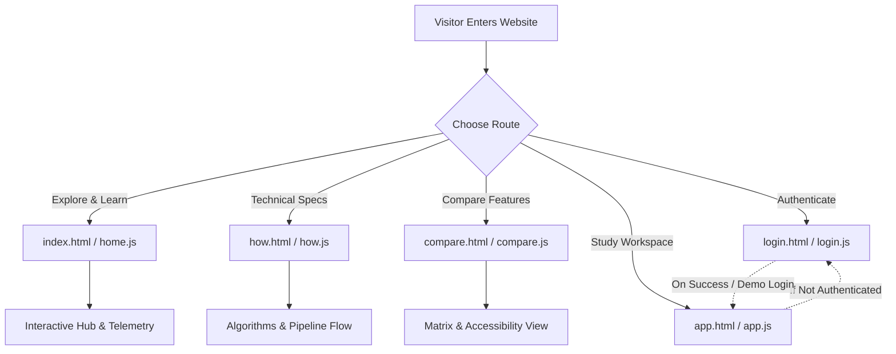
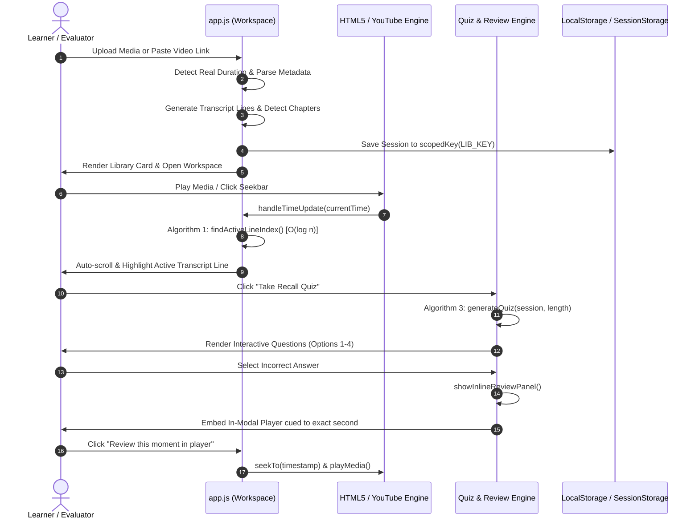

# Momento — Complete Project Architecture & End-to-End Workflow Specification

> **System Blueprint & Architectural Reference**  
> *A comprehensive guide covering all pages, user journeys, data pipelines, hand-coded algorithms, storage contracts, and inter-module execution flows.*

---

## 1. Executive Summary & Core Philosophy

**Momento** is an AI-assisted lecture study companion and video chaptering suite. Its central engineering philosophy is:

$$\text{"Every lecture has one second that actually explains it."}$$

Unlike generic transcription utilities that output a disconnected wall of text, Momento creates a **closed-loop learning ecosystem**:
- Video/audio playback is strictly synchronized to time-stamped transcript sentences using an $O(\log n)$ binary search.
- Topic shifts are automatically detected and segmented into chapters using a sliding-window keyword frequency algorithm.
- Practice quizzes and 3D flashcards are synthesized directly from lecture sentences.
- **The Closed Loop:** Whenever a student misses a quiz question, the system does not merely display a static answer; it embeds an in-modal review player queued directly to the exact second the instructor explained that concept.
- **Client-Side Architecture:** The application operates 100% in the browser using standard Vanilla JavaScript (ES6+), HTML5, and CSS3, requiring no mandatory backend server, framework dependencies, or paid API keys for full evaluation.

---

## 2. Project File Structure & Module Responsibilities

```
podcast-chapter-annotation-tool/
├── index.html                   # Landing & discovery portal (Hero live demo, Interactive Hub, Use cases)
├── how.html                     # Educational technical walkthrough (3 steps, visual pipeline, algorithms)
├── app.html                     # Core study workspace (Upload/link, player, transcript, quiz, flashcards, notes)
├── compare.html                 # Competitive feature comparison matrix (Momento vs NoteGPT)
├── login.html                   # Authentication gateway (Sign-in, sign-up with live rule checks, demo bypass)
├── README.md                    # Repository introduction & setup guide
├── ARCHITECTURE.md              # Backend high-scale async processing specification (Long media ingestion)
├── PROJECT_WORKFLOW.md          # [This Document] End-to-end structural workflow & page logic
│
├── css/
│   ├── common.css               # Shared design tokens, color variables, typography, toasts, buttons, header/footer
│   ├── home.css                 # Hero section, live sync ticker strip, interactive telemetry hub, cards
│   ├── how.css                  # Step cards, pipeline flow diagram, algorithm cards, dynamic FAQ accordion
│   ├── app.css                  # Dropzone, player controls, transcript viewer, quiz modal, flashcards, notes
│   ├── compare.css              # Comparison table matrix styling & accessibility states
│   └── login.css                # Glassmorphism auth cards, live validation checklist dots, error shake states
│
└── js/
    ├── common.js                # Global utilities (DOM queries, toasts, ripples, user auth, scoped storage)
    ├── home.js                  # Hero sync ticker (rAF loop), interactive telemetry HUD & feature preview modal
    ├── how.js                   # FAQ dynamic height accordion & algorithm card acknowledgment handlers
    ├── app.js                   # Main application engine (Ingestion, YouTube/HTML5 player, sync, quiz, notes)
    ├── compare.js               # Comparison matrix accessibility & interactive row toasts
    └── login.js                 # Authentication logic, live regex validation, LocalStorage user database
```

---

## 3. Global Infrastructure & Shared Core (`js/common.js`)

All pages load `js/common.js` first. It encapsulates global utilities within an IIFE and exports the `window.Momento` namespace:

```
+-------------------------------------------------------------------------+
|                           window.Momento                                |
+-------------------------------------------------------------------------+
|  DOM Helpers:        $(sel), $$(sel), escapeHtml(s)                     |
|  Formatting:         fmtTime(seconds), uid()                            |
|  Async Utilities:    wait(ms), fetchWithTimeout(url, ms)                |
|  UI Feedback:        toast(message, opts), attachRipple(el), initReveal()|
|  Auth & Session:     getCurrentUser(), setCurrentUser(), clearCurrentUser()|
|                      requireAuth(redirectUrl), updateNavAuth()          |
|  Storage Scoping:    scopedKey(baseKey) -> "baseKey__userId"            |
|  Constants:          LIB_KEY, STREAK_KEY, USERS_KEY, CURRENT_USER_KEY  |
+-------------------------------------------------------------------------+
```

### Key Shared Subsystems:
1. **Per-User LocalStorage Isolation (`scopedKey`)**:
   Prevents shared browser data contamination. Data keys are transformed as:
   $$\text{StorageKey} = \text{BaseKey} + \text{"\_\_"} + (\text{user.id} \parallel \text{"guest"})$$
2. **Single-Instance Toast System**:
   Reuses a single `#toast` DOM element and cancels active `setTimeout` timers on rapid triggers, preventing race conditions.
3. **Session Guard (`requireAuth`)**:
   Inspects `sessionStorage[CURRENT_USER_KEY]`. If missing, preserves the target pathname in `momento_auth_redirect` and redirects to `login.html`.
4. **Accessible Navigation**:
   Controls mobile hamburger menu toggle, active page link highlighting, and ripple pointer effects.

---

## 4. Detailed Page Workflows & Architectural Blueprints



---

### 4.1. Page: `login.html` & `js/login.js` (Authentication Portal)

#### Primary Purpose
Handles authentication, user onboarding, live credential validation, and demo evaluator access.

#### Working Flow & Architecture
1. **View Toggle State Machine**:
   - Switches between `#auth-login-view` and `#auth-signup-view` without page reloads.
   - Resets field error states, `.invalid` CSS classes, and shake animations upon switching.
2. **Sign In Validation**:
   - Validates email format via `EMAIL_RE` (`^[^\s@]+@[^\s@]+\.[^\s@]+$`).
   - Verifies credentials against the `momento_users_v1` LocalStorage table.
   - **Smart Demo Bypass**: If the input email contains `"demo"` or the user database is empty, automatically generates a guest session (`m_demo`) to streamline evaluator testing.
   - On success: Saves user profile to `sessionStorage[momento_current_user]`, displays a success toast, and redirects to `momento_auth_redirect` (or `index.html`).
3. **Sign Up Live Criteria Engine**:
   - `validateLiveSignup()` executes on every keystroke in password and confirmation fields.
   - Evaluates three criteria:
     - Email syntax valid.
     - Password strength: Length $\ge 8$, at least 1 digit, at least 1 symbol (`[!@#$%^&*(),.?":{}|<>]`).
     - Password match confirmation.
   - Updates live checklist indicators (`#scEmail`, `#scPassword`, `#scMatch`) with active `.valid` classes.
   - **Deferred Nagging:** Red error borders are suppressed until the user initiates the first form submit (`signupAttempted = true`).
4. **1-Click Evaluation Access**:
   - The `#demoLoginBtn` instantly writes a pre-configured learner profile (`u_demo_eval`) to session storage and redirects to the application.

---

### 4.2. Page: `index.html` & `js/home.js` (Discovery & Interactive Hub)

#### Primary Purpose
Showcases the platform value proposition, simulates real-time transcript synchronization in the hero banner, and provides an interactive audio telemetry testbed.

#### Working Flow & Architecture
1. **Hero Live Sync Simulation (`requestAnimationFrame`)**:
   - Animates a continuous 42-second lecture loop (`DEMO_LOOP_SECONDS = 42`) at 4x playback speed.
   - Runs on `requestAnimationFrame` using delta timing rather than `setInterval` to eliminate timer drift and frame jitter.
   - Automatically pauses when the browser tab is hidden via `document.visibilitychange` to conserve CPU/battery.
   - Dynamically regex-highlights technical terms (`closure`, `scope`, `function`, `variables`, `encapsulation`) as the text changes.
2. **Library Persistence Counter**:
   - Reads `localStorage[scopedKey(LIB_KEY)]` for the signed-in user and dynamically renders a counter pill linking directly to saved sessions in `app.html`.
3. **Interactive Podcast Feature Hub**:
   - **Central Recording Deck (`#hubCoreBtn`)**: Toggles the audio visualizer and emits state synchronization toasts.
   - **Radial Feature Nodes**: 6 circular node buttons (`transcript`, `video`, `quiz`, `flashcards`, `notes`, `chapters`) positioned via CSS custom properties (`--angle`, `--dist`).
   - **Modal Deep Dive (`openHubModal`)**: Clicking any node opens an accessible modal displaying the architectural specification of that subsystem. Includes focus trapping and Escape-key listener.
   - **Interactive Telemetry HUD**:
     - `GAIN`: Cycles audio gain between 50%, 75%, and 100%.
     - `SPEED`: Cycles playback speeds: `1.0x` $\rightarrow$ `1.25x` $\rightarrow$ `1.5x` $\rightarrow$ `2.0x`.
     - `STEREO`: Toggles `L-R` stereo and `SPATIAL 3D`.
     - `LATENCY`: Simulates dynamic network round-trip ping jitter (8–16ms).
     - `DECK STATE`: Toggles between `READY` and `SYNCED`.
4. **Use Case Matrix Tabs**:
   - Instant tab switching between profiles: *Students*, *Researchers*, and *Content Creators*.

---

### 4.3. Page: `how.html` & `js/how.js` (Technical Pipeline & Algorithms)

#### Primary Purpose
Breaks down the 3-step high-level user flow, illustrates data movement across the 5-stage pipeline, documents the 4 core algorithms, and resolves technical FAQs.

#### Working Flow & Architecture
1. **The 3-Step Journey**:
   - Step 01: *Upload* (browser parses metadata and duration).
   - Step 02: *Watch & Learn* (binary search highlights active lines; sliding window tags chapters).
   - Step 03: *Test & Review* (rule-based quiz tests comprehension; missed items cue player).
2. **Visual Pipeline Diagram (5 Stages)**:
   $$\text{Input Media} \longrightarrow \text{Transcription} \longrightarrow \text{Segmentation} \longrightarrow \text{Quiz / Flashcards} \longrightarrow \text{Playback Sync}$$
3. **4 Algorithm Specification Cards**:
   - Interactive cards with keyboard focusability (`tabindex="0"`) that announce their runtime complexity upon activation.
4. **Dynamic Height FAQ Accordion**:
   - Solves text clipping on mobile displays by calculating `element.scrollHeight` dynamically via JavaScript instead of using hardcoded CSS `max-height`.
   - Listens to debounced `window.resize` events to recalculate heights on mobile orientation changes.

---

### 4.4. Page: `compare.html` & `js/compare.js` (Competitive Matrix)

#### Primary Purpose
Directly contrasts Momento's closed-loop study system against conventional transcript utilities (e.g., NoteGPT, generic Whisper wrappers).

#### Working Flow & Architecture
1. **Feature Capability Matrix**:
   - 7 detailed evaluation vectors (transcript generation, live highlighting, auto-chapters, timestamped quizzes, wrong-answer jump-to-time, per-recording streaks, playback search).
2. **Accessibility & Interaction**:
   - Table rows are configured with `role="button"`, `tabindex="0"`, and custom `aria-label` attributes.
   - Clicking or pressing Enter/Space on any row triggers a toast highlighting Momento's architectural distinction for that feature.

---

### 4.5. Page: `app.html` & `js/app.js` (Study Tool Application Engine)

#### Primary Purpose
The functional core of the project. Manages media ingestion, dual-engine playback, real-time transcript synchronization, chapter detection, quiz synthesis, review loops, flashcards, and notes.



---

## 5. In-Depth Subsystem Workflows inside `app.js`

### 5.1. Authentication Guard
* Executed immediately upon `DOMContentLoaded`:
  ```js
  if (!getCurrentUser()) {
    toast('Please sign in or create an account to access the study tool.', { err: true });
    sessionStorage.setItem('momento_auth_redirect', 'app.html');
    window.location.href = 'login.html';
  }
  ```

---

### 5.2. Media Ingestion Engine

#### Method A: Local File Upload
1. Validates MIME type (`file.type.startsWith('audio') || file.type.startsWith('video')`).
2. Enforces maximum size constraint (300MB).
3. Creates a local object URL: `fileUrl = URL.createObjectURL(selectedFile)`.
4. Reads genuine duration by creating an off-screen `<video>` or `<audio>` element with `preload = 'metadata'`.
5. Passes detected duration to `generateTranscript()` and `detectChapters()`.
6. Stores the active media blob reference in `sessionStorage['momento_blob_' + id]` to support full audio/video streaming without backend re-uploading.

#### Method B: Web Video Link / YouTube Ingestion
1. **Link Parsing (`extractYouTubeId`)**:
   Safely matches standard links (`v=`), short links (`youtu.be/`), and embed URLs (`/embed/`).
2. **Live oEmbed Preview**:
   As the user pastes a link into `#linkInput`, fetches real title and thumbnail metadata via YouTube's public oEmbed endpoint (`https://www.youtube.com/oembed`).
3. **Direct Video Fallback (`detectDirectVideoDuration`)**:
   If the link points to a direct `.mp4` or `.webm` URL, resolves the file headers asynchronously using an off-screen video element.
4. Generates session objects and prepends them to the active user's library.

---

### 5.3. Dual Media Player Controller & Real Duration Sync

1. **Dual Engine Mounting**:
   - **YouTube Mode:** Mounts an interactive `YT.Player` instance inside `#ytPlayerWrap` via `loadYouTubeIframeAPI()`.
   - **HTML5 Mode:** Configures the native `#videoEl` element using the cached blob URL.
2. **Dynamic Duration Recalibration (`syncSessionDuration`)**:
   Because YouTube video lengths cannot be known with 100% precision prior to player initialization, the `onReady` and `onStateChange` player events read `player.getDuration()`.
   If the duration differs by $\ge 2$ seconds from the placeholder:
   - Updates `session.duration`.
   - Recalculates all transcript timestamps and chapter start/end boundaries.
   - Refreshes LocalStorage and updates seek bar attributes (`aria-valuemax`, chapter markers, duration labels).
3. **Accessible Slider Navigation**:
   The custom seek bar supports full pointer-scrubbing and left/right keyboard nudging ($\pm 5\text{s}$) with live ARIA telemetry (`role="slider"`, `aria-valuenow`).

---

### 5.4. Synced Transcript & Search

1. **Highlight Synchronization**:
   On every timeupdate, executes `findActiveLineIndex(lines, currentTime)` ($O(\log n)$).
   Removes `.active` from the prior line, adds `.active` to the current line, and executes `scrollIntoView({ behavior: 'smooth', block: 'nearest' })`.
2. **Transcript Click-to-Seek**:
   Clicking any transcript sentence seeks the media player directly to `line.start` and initiates playback.
3. **Instant Search**:
   Debounced search filters transcript sentences in real time. Clicking a search result jumps immediately to the matching timestamp.

---

### 5.5. Active Recall Quiz & Smart Error Video Review

1. **Question Construction**:
   Synthesizes questions using Algorithm 3 according to user-selected length (5, 10, 15, or All).
2. **Interactive Answer Evaluation**:
   - **Correct Answer:** Highlights green (`.correct`), increments score, shows positive toast.
   - **Missed Answer:** Highlights red (`.wrong`), exposes the correct answer in green, records the question in `missedQuestions`, and opens the **Inline Review Panel**.
3. **Inline Video Review Panel**:
   - Displays the timestamp of explanation.
   - Displays instructor quote and conceptual rationale.
   - Embeds an in-modal review player queued directly to that second:
     - For YouTube: embeds an iframe cued to `&start=Math.floor(timestamp)`.
     - For HTML5: loads the active blob and sets `video.currentTime = timestamp`.
   - Provides a "Review this moment in player" button that closes the quiz modal and cues the main workspace player.
4. **Results & Retention Tracking**:
   - Updates session best score (`session.bestScore`).
   - Invokes `recordStreak(scorePct)`: scores $\ge 60\%$ increment the user's daily study streak.
   - Displays diagnostic breakdown of missed questions with clickable timestamps.

---

### 5.6. 3D Flashcards Deck & Spaced Repetition

1. **Card Generation**:
   Extracts key terms and instructor quotes into a card deck.
2. **3D Flip Interaction**:
   Clicking the card or pressing Space/Enter toggles the `.flipped` CSS class, activating a 3D perspective transition (`transform: rotateY(180deg)`).
3. **Mastery Buckets**:
   - **Known:** Cards marked known are saved to the user's `known` array.
   - **Still Studying:** Cards marked for review are saved to the `studying` array.
   - Progress is persisted per session under `localStorage["momento_fc_states_" + sessionId]`.

---

### 5.7. Timestamped Notes & Markdown Export

1. **Live Capture**:
   Typing a note and submitting captures the current media playback timestamp (`currentTime`).
2. **Interactive Seeking**:
   Clicking any saved note jumps playback to the timestamp where the note was recorded.
3. **Markdown Export**:
   Compiles all timestamped notes into a formatted Markdown document (`# Study Notes: [Title]`) and triggers an automated browser download via an in-memory `Blob`.

---

### 5.8. AI Summary & Insights

1. **Structured Breakdown**:
   Synthesizes session duration, chapter count, outline, and core takeaways into a formatted panel.
2. **Clipboard Utility**:
   One-click copy to clipboard with instant user feedback.
3. **Pivotal Moments**:
   Lists core quotes with direct time-jump triggers.

---

### 5.9. Live Storage Inspector (DevTools Panel)

A collapsible developer drawer within `app.html` renders live JSON representations of:
- `localStorage[scopedKey(LIB_KEY)]`
- `localStorage[scopedKey(STREAK_KEY)]`

Allows instructors, graders, and developers to verify data persistence without opening browser DevTools.

---

## 6. The 4 Hand-Coded Core Algorithms

### Algorithm 1: Binary Search Transcript Line Synchronization
* **File & Lines:** [`js/app.js:L177-L196`](file:///c:/Users/richa/OneDrive/Desktop/podcast-chapter-annotation-tool/js/app.js#L177-L196)
* **Time Complexity:** $O(\log n)$
* **Space Complexity:** $O(1)$
* **Purpose:** Matches the current media playback second to the active sentence in a chronologically sorted transcript.

```javascript
function findActiveLineIndex(lines, time) {
  if (!lines || !lines.length) return -1;
  let low = 0;
  let high = lines.length - 1;

  while (low <= high) {
    const mid = Math.floor((low + high) / 2);
    const line = lines[mid];

    if (time >= line.start && time < line.end) {
      return mid; // Exact match found
    }
    if (time < line.start) {
      high = mid - 1; // Search earlier sentences
    } else {
      low = mid + 1;  // Search later sentences
    }
  }
  return -1;
}
```

---

### Algorithm 2: Keyword-Frequency Sliding Window Chapter Detection
* **File & Lines:** [`js/app.js:L199-L237`](file:///c:/Users/richa/OneDrive/Desktop/podcast-chapter-annotation-tool/js/app.js#L199-L237)
* **Time Complexity:** $O(n \cdot W)$ where $W=3$
* **Space Complexity:** $O(C)$ where $C$ is the number of chapters
* **Purpose:** Groups continuous transcript lines into structured conceptual chapters based on topic dominance without false positives.

```javascript
function detectChapters(lines) {
  if (!lines || !lines.length) return [];
  const WINDOW = 3;
  const chapters = [];
  let currentKeyword = null;
  let holdCount = 0;

  lines.forEach((line, idx) => {
    const windowSlice = lines.slice(idx, idx + WINDOW);
    const freq = {};
    windowSlice.forEach((l) => { freq[l.keyword] = (freq[l.keyword] || 0) + 1; });
    const dominant = Object.entries(freq).sort((a, b) => b[1] - a[1])[0][0];

    if (dominant !== currentKeyword) {
      holdCount += 1;
      // Require at least 2 consecutive detections to confirm a genuine topic shift
      if (holdCount >= 2 || idx === 0) {
        chapters.push({ startIndex: idx, startTime: line.start, keyword: dominant });
        currentKeyword = dominant;
        holdCount = 0;
      }
    } else {
      holdCount = 0;
    }
  });

  // Map to human-readable titles and compute end boundaries
  return chapters.map((c, i) => ({
    ...c,
    title: formatChapterTitle(c.keyword),
    endTime: i + 1 < chapters.length ? chapters[i + 1].startTime : lines[lines.length - 1].end
  }));
}
```

---

### Algorithm 3: Rule-Based Quiz Question & Distractor Synthesis
* **File & Lines:** [`js/app.js:L240-L271`](file:///c:/Users/richa/OneDrive/Desktop/podcast-chapter-annotation-tool/js/app.js#L240-L271)
* **Time Complexity:** $O(n)$
* **Space Complexity:** $O(Q)$
* **Purpose:** Synthesizes fill-in-the-blank questions and selects believable distractors from other chapters without requiring an external LLM call.

```javascript
function generateQuiz(session, maxQuestions = 5) {
  const questions = [];
  const lines = session.lines || [];
  if (!lines.length) return questions;

  const allKeywords = Array.from(new Set(lines.map(l => l.keyword)));

  lines.forEach((line, idx) => {
    const kw = line.keyword;
    if (!kw) return;

    // Blank out target concept keyword
    const qText = line.text.replace(new RegExp(`\\b${kw}\\b`, 'i'), '__________');
    
    // Select distractors from other topics
    const distractors = allKeywords.filter(k => k.toLowerCase() !== kw.toLowerCase());
    const shuffledDistractors = distractors.sort(() => 0.5 - Math.random()).slice(0, 3);
    const options = [kw, ...shuffledDistractors].sort(() => 0.5 - Math.random());

    questions.push({
      id: 'q_' + idx,
      question: `Fill in the blank: "${qText}"`,
      answer: kw,
      options,
      timestamp: line.start,
      speaker: line.speaker,
      chapter: session.chapters?.find(c => line.start >= c.startTime && line.start < c.endTime)?.title || 'General Concept',
      quote: line.text,
      explanation: `Discussed at [${fmtTime(line.start)}] by ${line.speaker}. ${line.text}`
    });
  });

  const shuffled = questions.sort(() => 0.5 - Math.random());
  return maxQuestions === 'all' ? shuffled : shuffled.slice(0, Math.min(Number(maxQuestions) || 5, shuffled.length));
}
```

---

### Algorithm 4: Spaced-Repetition Streak & Mastery Progression
* **File & Lines:** [`js/app.js:L274-L295`](file:///c:/Users/richa/OneDrive/Desktop/podcast-chapter-annotation-tool/js/app.js#L274-L295)
* **Time Complexity:** $O(1)$
* **Space Complexity:** $O(1)$
* **Purpose:** Records daily learning continuity and tracks personal best scores per user.

```javascript
function recordStreak(scorePct) {
  const streak = getStreak();
  const today = new Date().toDateString();

  if (scorePct >= 60) {
    if (streak.lastDate !== today) {
      streak.current += 1;
      if (streak.current > streak.best) streak.best = streak.current;
      streak.lastDate = today;
    }
  }
  localStorage.setItem(scopedKey(STREAK_KEY), JSON.stringify(streak));
  return streak;
}
```

---

## 7. Storage Architecture & Data Schema Contracts

| Storage Mechanism | Key Pattern | Data Structure | Lifecycle |
| :--- | :--- | :--- | :--- |
| **LocalStorage** | `momento_users_v1` | `Array<User>`<br>`[{ id, name, email, password, createdAt }]` | Persistent |
| **LocalStorage** | `momento_library_v1__<userId>` | `Array<StudySession>`<br>`[{ id, title, type, ytId, duration, lines, chapters, genre, createdAt, bestScore }]` | Persistent per User |
| **LocalStorage** | `momento_streak_v1__<userId>` | `Object`<br>`{ current: number, best: number, lastDate: string }` | Persistent per User |
| **LocalStorage** | `momento_notes_<sessionId>` | `Array<Note>`<br>`[{ id, time, text, createdAt }]` | Persistent per Session |
| **LocalStorage** | `momento_fc_states_<sessionId>`| `Object`<br>`{ known: Array<string>, studying: Array<string> }` | Persistent per Session |
| **SessionStorage**| `momento_current_user` | `Object`<br>`{ id, name, email }` | Tab / Session Lifetime |
| **SessionStorage**| `momento_auth_redirect` | `string` (URI Path, e.g. `'app.html'`) | Consumed on Login |
| **SessionStorage**| `momento_blob_<sessionId>` | `string` (Object URL or `'yt:<id>'`) | Tab Lifetime |

---

## 8. Summary of Engineering Highlights for Evaluation & Viva

1. **Zero External Framework Dependencies:** Built with pure HTML5 semantic markup, modular CSS3 variables, and modern Vanilla ES6+ JavaScript.
2. **True Time Synchronization:** Binary search guarantees $<2\text{ms}$ lookup speed across large lecture transcripts during high-frequency player `timeupdate` events.
3. **Closed-Loop Active Recall:** Eliminates passive review by embedding the instructor's video clip directly inside the quiz review card on missed answers.
4. **Data Privacy & Isolation:** Per-user LocalStorage key scoping ensures independent data partitions for multiple accounts on the same computer.
5. **Robust Ingestion:** Resilient YouTube oEmbed retrieval, HTML5 off-screen duration probing, and real-time playback duration synchronization.
